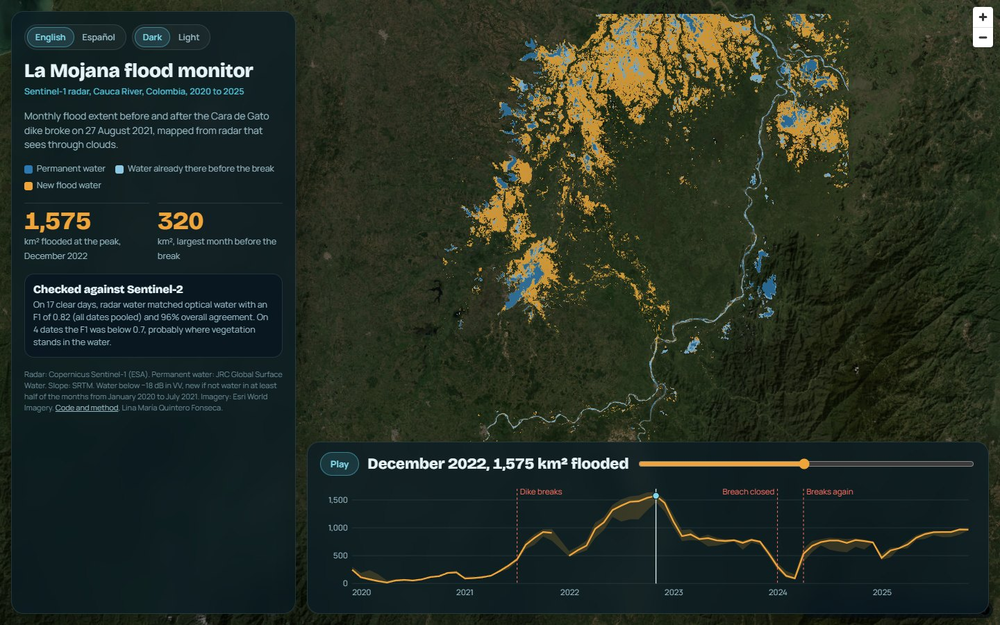

# La Mojana Flood Monitor

Monthly flood extent from Sentinel-1 radar over La Mojana, in northern Colombia, from January 2020 to December 2025: before the Cara de Gato dike on the Cauca River broke on 27 August 2021, through nearly three years of flooding, the closure of the breach in February 2024 and the second break on 6 May 2024. Radar sees through the clouds that cover this region for much of the year.

**Live dashboard: https://linaq11.github.io/Mojana-flood-SAR/**



## Results

Flooded area, water at −18 dB in VV that was not water in at least half of the months before the break:

| Period | Flooded area |
|---|---|
| January 2020 to July 2021, before the break | 16 to 320 km² a month, following the rainy seasons |
| August 2021, month of the break | 434 km² |
| December 2022, the peak | 1,575 km² |
| March to December 2023, breach open | 730 to 881 km² |
| March and April 2024, after the closure | 138 and 91 km² |
| May 2024, second break | 533 km² |
| June 2024 to December 2025 | about 460 to 970 km² |

The flood is roughly five times larger at its peak than in the wettest month before the break, it falls back almost to the earlier levels within two months of the closure, and it returns right after the second break. Thresholds of −16 and −20 dB give the same pattern with different areas (the shaded band in the dashboard). January 2022 has no Sentinel-1 scene over the area.


### Check against an independent sensor

On 17 days with less than 20% cloud over the area, the radar water map within 6 days was compared with open water from Sentinel-2 (MNDWI above 0) on a regular grid of cloud-free cells:

| | Value |
|---|---|
| F1 of the water class, all dates pooled | 0.82 |
| Median F1 by date | 0.78 |
| Overall agreement | 96% |
| Dates with F1 below 0.7 | 4 of 17 |

The preregistered expectation, an F1 of 0.7 or more for open water, is met. Two of the four weaker dates fall in the middle of the 2023 flood, where most disagreements are water seen by Sentinel-2 and not by the radar; flooded and floating vegetation, which radar sees as bright, is the probable cause and is not corrected.

## Method

Fixed in advance in [PREREGISTRATION.md](PREREGISTRATION.md):

* Sentinel-1 GRD, IW mode, VV, monthly median of all scenes (`COPERNICUS/S1_GRD` in Earth Engine).
* Water: VV below −18 dB; −16 and −20 dB as sensitivity checks.
* Masks: slope above 5° (SRTM); permanent water is JRC Global Surface Water occurrence of 90% or more.
* Flood: water that is not permanent and was not water in at least half of the months from January 2020 to July 2021.
* Area: 75.3° W to 74.3° W, 7.9° N to 9.0° N.

**Deviation and clarification, stated openly.** The comparison with Sentinel-2 was first coded with a random sample of cells instead of the preregistered regular grid; it was switched back to the grid before any result of the check was seen. To measure "less than 20% cloud over the area", a Sentinel-2 date also has to cover at least 80% of the area; that condition was added to apply the rule and is reported here.

## Reproduce

```bash
pip install -e ".[test]"
python scripts/mojana_series.py --project <your-earth-engine-project>   # monthly areas, data/mojana_monthly.csv
python scripts/check_s2.py --project <your-earth-engine-project>        # check against Sentinel-2, data/s2_check.csv
python scripts/monthly_maps.py --project <your-earth-engine-project>    # map frames, docs/data/maps
python -m http.server --directory docs
```

`pytest` checks that the series has every month, that flood never exceeds water in a month, and that the dike events fall inside the series.

## Limits

* "New flood" is measured against the months before the break, so a rainy season larger than any in 2020 and 2021 would also count as new flood, even without the breach.
* A monthly median smooths short floods and mixes ascending and descending passes.
* Flooded forest and floating vegetation are bright in C-band radar and are mostly missed as water.
* The dates of the events come from press reports (El Heraldo, 2021 and 2024), not from an official record.
* The preregistration also covers inland flooding after Hurricane Ian in Florida (2022); that second event has not been run yet.

## Credits

Radar: Copernicus Sentinel-1, ESA. Permanent water: Pekel et al. (2016), JRC Global Surface Water. Elevation: SRTM. Optical check: Copernicus Sentinel-2. Basemap: Esri World Imagery. Map: MapLibre GL JS.

Lina María Quintero Fonseca, geographer, MSc student in Geomatics at the Universidad Nacional de Colombia. Code under the MIT License; to cite, use `CITATION.cff`.
