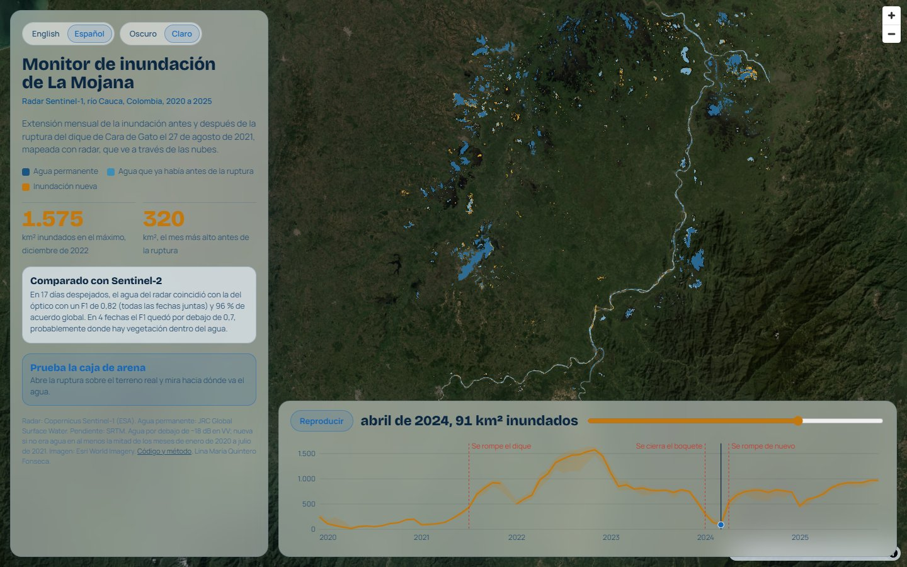
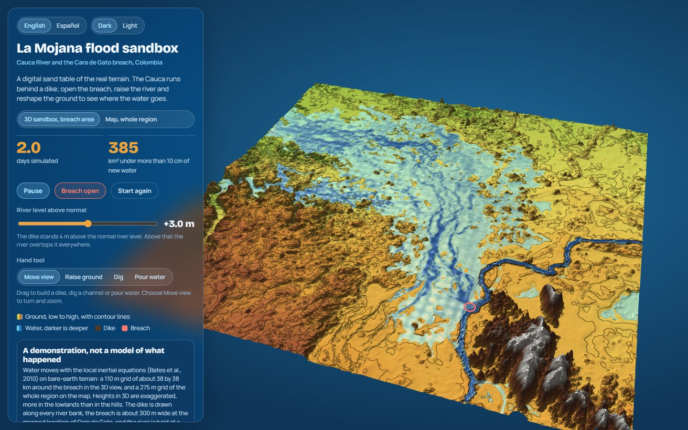

# La Mojana Flood Monitor

Monthly flood extent from Sentinel-1 radar over La Mojana, in northern Colombia, from January 2020 to December 2025: before the Cara de Gato dike on the Cauca River broke on 27 August 2021, through nearly three years of flooding, the closure of the breach in February 2024 and the second break on 6 May 2024. Radar sees through the clouds that cover this region for much of the year.

**Live dashboard: https://linaq11.github.io/Mojana-flood-SAR/**


## Results

Flooded area, water at −18 dB in VV that was not water in at least half of the months before the break:

| Period | Flooded area |
|---|---|
| January 2020 to July 2021, before the break | 16 to 320 km² a month, following the rainy seasons |
| August 2021, month of the break | 434 km² |
| December 2022, the peak | 1,575 km² |
| March to December 2023, breach open | 730 to 881 km² |
| March and April 2024, after the closure | 138 and 91 km² |
| May 2024, second break | 533 km² |
| June 2024 to December 2025 | about 460 to 970 km² |

The flood is roughly five times larger at its peak than in the wettest month before the break, it falls back almost to the earlier levels within two months of the closure, and it returns right after the second break. Thresholds of −16 and −20 dB give the same pattern with different areas (the shaded band in the dashboard). January 2022 has no Sentinel-1 scene over the area.



### Check against an independent sensor

On 17 days with less than 20% cloud over the area, the radar water map within 6 days was compared with open water from Sentinel-2 (MNDWI above 0) on a regular grid of cloud-free cells:

| | Value |
|---|---|
| F1 of the water class, all dates pooled | 0.82 |
| Median F1 by date | 0.78 |
| Overall agreement | 96% |
| Dates with F1 below 0.7 | 4 of 17 |

The preregistered expectation, an F1 of 0.7 or more for open water, is met. Two of the four weaker dates fall in the middle of the 2023 flood, where most disagreements are water seen by Sentinel-2 and not by the radar; flooded and floating vegetation, which radar sees as bright, is the probable cause and is not corrected.

## Flood sandbox

**https://linaq11.github.io/Mojana-flood-SAR/sandbox/**

A digital version of an augmented-reality sandbox, on the real terrain of La Mojana. The Cauca runs behind a dike; you can open or close the breach at Cara de Gato, raise the river, build or dig the ground by dragging, and pour water. The 3D view is a close-up of about 38 by 38 km around the breach, coloured by height with contour lines like a sand table; the map view covers the whole region and can lay the radar flood of December 2022 underneath for comparison.



How it works, all in the browser:

* Terrain: FABDEM, the Copernicus 30 m surface model with forests and buildings removed, averaged to a 0.001° grid around the breach for the 3D view (about 110 m, 350 by 350 cells) and to a 0.0025° grid of the whole region for the map (about 275 m, 400 by 440 cells). Heights in 3D are drawn on a logarithmic scale above the lowest ground, so the lowlands are exaggerated more than the hills.
* Rivers: cells with more than 40,000 km² of drainage area in MERIT Hydro, which picks out the Cauca downstream of Caucasia and the Magdalena. Their normal level is a running median of the terrain along the channel that never rises downstream.
* Dike: every land cell that shares an edge with a river cell, raised to 4 m above the normal river level. The breach is the dike cell nearest to the OpenStreetMap feature "Caregato" (8.1553° N, 74.7903° W) and the dike cells within 160 m of it: three cells, about 300 m, on the close-up grid, and one 275 m cell on the regional grid.
* Flow: the local inertial equations of Bates et al. (2010), Manning's n of 0.05, a time step limited by the wave speed, and a limiter so that no cell loses more water than it holds. The river cells are held at the chosen level and the edges of the grid drain freely.

**It is a demonstration, not a validated model.** There is no rain, infiltration, real river hydrograph or calibration, the dike is drawn along every bank instead of where dikes exist, and the breach width is set by the grid, not measured. Times and areas in the sandbox are not predictions and are not compared with the radar series. The model was written twice, in NumPy and in JavaScript, and both give the same flooded area after 12 simulated hours (41 km² with the breach open, under 1 km² with it closed), on the regional grid, which checks the code, not the physics.

## Method

Fixed in advance in [PREREGISTRATION.md](PREREGISTRATION.md):

* Sentinel-1 GRD, IW mode, VV, monthly median of all scenes (`COPERNICUS/S1_GRD` in Earth Engine).
* Water: VV below −18 dB; −16 and −20 dB as sensitivity checks.
* Masks: slope above 5° (SRTM); permanent water is JRC Global Surface Water occurrence of 90% or more.
* Flood: water that is not permanent and was not water in at least half of the months from January 2020 to July 2021.
* Area: 75.3° W to 74.3° W, 7.9° N to 9.0° N.

**Deviation and clarification, stated openly.** The comparison with Sentinel-2 was first coded with a random sample of cells instead of the preregistered regular grid; it was switched back to the grid before any result of the check was seen. To measure "less than 20% cloud over the area", a Sentinel-2 date also has to cover at least 80% of the area; that condition was added to apply the rule and is reported here.

## Reproduce

```bash
pip install -e ".[test]"
python scripts/mojana_series.py --project <your-earth-engine-project>   # monthly areas, data/mojana_monthly.csv
python scripts/check_s2.py --project <your-earth-engine-project>        # check against Sentinel-2, data/s2_check.csv
python scripts/monthly_maps.py --project <your-earth-engine-project>    # map frames, docs/data/maps
python scripts/sandbox_grid.py --project <your-earth-engine-project>    # regional grid, docs/sandbox/grid.json
python scripts/sandbox_grid.py --project <your-earth-engine-project> --zone breach   # close-up grid, docs/sandbox/grid_breach.json
python -m http.server --directory docs
```

`pytest` checks that the series has every month, that flood never exceeds water in a month, that the dike events fall inside the series, and that both sandbox grids have no holes and their breach sits within about 2 km of the river channel.

## Limits

* "New flood" is measured against the months before the break, so a rainy season larger than any in 2020 and 2021 would also count as new flood, even without the breach.
* A monthly median smooths short floods and mixes ascending and descending passes.
* Flooded forest and floating vegetation are bright in C-band radar and are mostly missed as water.
* The dates of the events come from press reports (El Heraldo, 2021 and 2024), not from an official record.
* The preregistration also covers inland flooding after Hurricane Ian in Florida (2022); that second event has not been run yet.

## Credits

Radar: Copernicus Sentinel-1, ESA. Permanent water: Pekel et al. (2016), JRC Global Surface Water. Elevation: SRTM. Optical check: Copernicus Sentinel-2. Basemap: Esri World Imagery. Map: MapLibre GL JS.

Sandbox: FABDEM, Hawker et al. (2022), *Environmental Research Letters* 17, 024016, produced using Copernicus WorldDEM-30 © DLR e.V. 2010-2014 and © Airbus Defence and Space GmbH 2014-2018, provided under Copernicus by the European Union and ESA. MERIT Hydro, Yamazaki et al. (2019), *Water Resources Research* 55, 5053-5073. Breach location © OpenStreetMap contributors (ODbL). Flow equations: Bates, Horritt and Fewtrell (2010), *Journal of Hydrology* 387, 33-45. 3D: three.js. `docs/sandbox/grid.json` and `docs/sandbox/grid_breach.json` are derived from FABDEM, which allows non-commercial use only, and from MERIT Hydro (CC BY-NC 4.0 or ODbL 1.0), so those files are not covered by the MIT License and may be used for non-commercial purposes only.

Lina María Quintero Fonseca, geographer, MSc student in Geomatics at the Universidad Nacional de Colombia. Code under the MIT License; to cite, use `CITATION.cff`.
